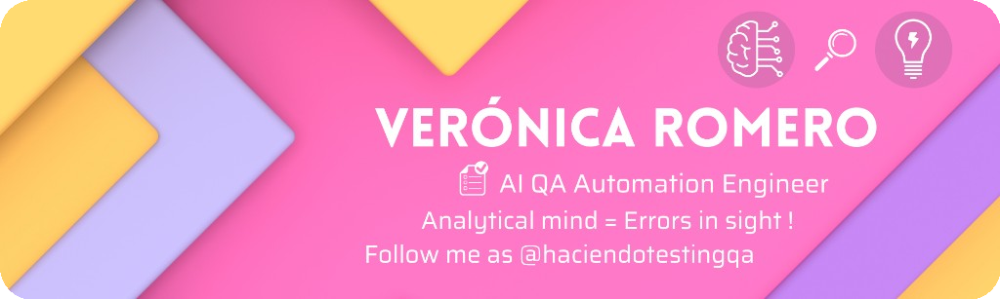

<!-- GitHub profile: https://github.com/haciendotestingqa/haciendotestingqa -->
<!-- Emojis como imágenes Twemoji (CDN) para que se vean bien aunque el SO/navegador no pinte Unicode. -->

  

 

#  Hi, I'm Veronica Romero

### AI QA Engineer | SDET | Web, Mobile & API Automation Specialist (Playwright, TypeScript, Maestro, K6, Pact, Newman) | Testing & Quality for AI-Driven Applications | C1 English

 *Analytical mindset — issues surfaced early*

---

 

 I am an <strong>AI QA Engineer & SDET</strong> focused on building resilient software quality strategies: clear acceptance criteria, traceable defects, and testing suites that mirror real-world environments across web, mobile, and omnichannel ecosystems.  

 I specialize in bridge-building between development and quality—combining comprehensive exploratory and functional testing with robust, maintainable test automation, API integration, contract testing, performance validation, and AI quality evaluations for LLM-driven workflows. I work seamlessly within Agile/Scrum frameworks alongside remote, multicultural teams.  

###  In my services and engineering approach, I offer:

-  <strong>Test Strategy & Management:</strong> Testmo, Jira, Confluence, Xray, Freshdesk; for risk-based test plans, cases, and meticulous ticket tracking; Figma for UI/UX prototype validation.
-  <strong>API & Contract Testing:</strong> Postman, Newman, Bruno, Pact; for robust payload validation, negative scenarios, and microservices contract integrity.
-  <strong>End-to-End & Mobile Automation:</strong> Playwright (Web) and Maestro (Mobile Android/iOS); for writing scalable, reliable automation suites with stable selectors.
-  <strong>Performance & Scalability:</strong> K6; for load, stress, and latency testing under heavy concurrency and traffic spikes.
-  <strong>Environments, Data & Infrastructure:</strong> Docker for isolated test executions; MariaDB, MySQL, PostgreSQL, DBeaver for deep database and backend state validation.
-  <strong>Web Analytics & Tracking:</strong> Google Analytics and Google Tag Manager event tracking validation.
-  <strong>AI-Driven & Modern Workflows:</strong> LLM output evaluation (accuracy, relevance, hallucination checks); leveraging advanced IDEs and AI assistants (Cursor, MCP agents, Gemini, ChatGPT) under strict human review to optimize coverage and test delivery.
-  <strong>Version Control & Collaboration:</strong> Git, GitHub, AWS Device Farm, Android Studio, Xcode.

 

 **Languages:** Spanish (native), English (professional working proficiency), Japanese (basic).

 **GitHub — hands-on examples (API, integration, E2E):** [github.com/haciendotestingqa](https://github.com/haciendotestingqa)

---

###  Connect with me

  
  &nbsp;&nbsp;
  
  &nbsp;&nbsp;
  

---

###  Languages & tools

  

  
  
  
  
  

  
  &nbsp;&nbsp;
  
  &nbsp;&nbsp;
  
  &nbsp;&nbsp;
  
  &nbsp;&nbsp;
  
  &nbsp;&nbsp;
  

---

<!-- Footer wave: Capsule Render — gradient aligned with assets/banner.png (gold/yellow → magenta/pink). -->

